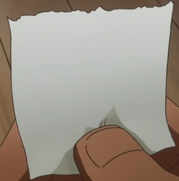

# 🚨 OFFICIAL NAVY COMMUNIQUÉ 🚨

## Subject: Naval Base Attack — Wanted Notice

On the night of September 25, our naval base was attacked by an unidentified group of pirates. The attackers took advantage of the confusion to steal sensitive documents before fleeing the scene.

At dawn, our teams inspected the premises. A document was found on the ground near the main entrance, presumably dropped by one of the fugitives in their haste to escape.

An initial analysis suggests that it may reveal its owner's intentions, including a public appearance scheduled to take place in the coming days.

## Your Mission

We call upon anyone capable of analyzing this clue to identify the following information:

- 👤 The identity of the pirate in question
- 🌍 The targeted city
- 🕒 The announced time of their appearance

These three pieces of information will allow us to formally establish the wanted notice.

## Evidence



> The image above is the only document recovered from the scene.

---

### Expected Format

```text
CTF{first_name_city_time}

Example: CTF{luffy_osaka_14:34}
```
